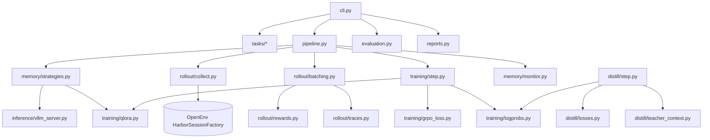
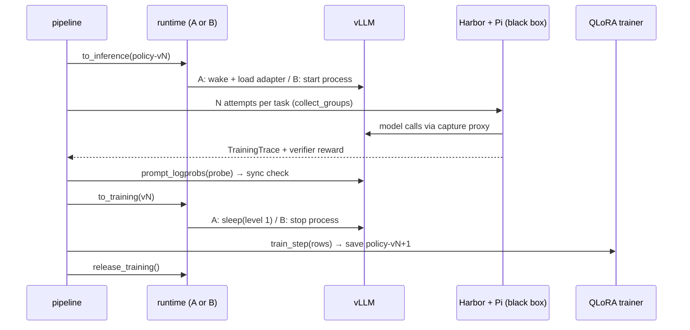

# Code graph: where to start reading

`src/harness_rl/` is split into a **pure core**, which you can test without a GPU, and a **thin I/O shell** (processes, HTTP, CUDA). Read it in this order:

| # | File | What it answers | Pure? |
|---|---|---|---|
| 1 | `rollout/traces.py` | How a captured Pi model call becomes trainable tokens. Which tokens are masked. | yes |
| 2 | `rollout/rewards.py`, `rollout/batching.py` | Verifier reward → group advantage → training rows; the sync probe | yes |
| 3 | `training/grpo_loss.py`, `training/logprobs.py` | The GRPO surrogate (beta=0) and chunked log-probs over the 151k vocab | torch only |
| 4 | `training/step.py`, `training/qlora.py` | One optimizer step on NF4 + LoRA, and the evidence that weights moved | GPU |
| 5 | `memory/strategies.py` | **Strategy A (sleep) vs. B (sequential)**: the Day 1 comparison | GPU + processes |
| 6 | `pipeline.py` | The loop that ties 1–5 together | orchestration |
| 7 | `cli.py` | Entry points | shell |

Then `tasks/` (dataset → splits → Harbor layout), `evaluation.py`, `reports.py`, `distill/` (Experiment B).

## Module dependencies

## One GRPO iteration (`pipeline.iteration`)

## What is reused and what is custom

| Reused unchanged | Custom (allowed by scope s.10) |
|---|---|
| Pi harness, Harbor tasks and verifier, Docker sandbox | GPU hand-over: `memory/strategies.py` |
| OpenEnv capture proxy, `TrainingTrace`, `HarborSessionFactory` | Phase-synchronous scheduler: `pipeline.py` |
| vLLM runtime LoRA loading (`policy-vN` naming, as in TRL) | Privileged teacher scoring: `distill/` |
| TRL's loss rule (`score_centering=False` branch) and advantage rule | Evaluation and reports |

## Alignment with TRL's harness trainer (checked 2026-11-17)

The GRPO loop is custom, not a TRL trainer class: it neither uses `GRPOTrainer` (TRL's
white-box path, where TRL owns the tool loop) nor `HarnessAsyncGRPOTrainer` (TRL's
black-box path). The stock black-box trainer is asynchronous and syncs weights into a
vLLM that stays up the whole time, and it has no hook to sleep or stop vLLM, so it
cannot run either GPU memory strategy (scope s.4). TRL appears only in
`scripts/probe_stock_trainer.py`.

The trace pipeline was checked against TRL main (`trl/experimental/async_grpo/openenv_harness.py`,
`trl/trainer/async_grpo_trainer.py`) and OpenEnv v0.7.0 (`envs/harbor_env/harness.py`,
`openenv/core/harness/capture/upstream.py`):

| Step | This repo | TRL / OpenEnv | Match |
|---|---|---|---|
| Session | `factory.create` → `wait_for_completion` → `fetch_training_trace` | same calls | yes |
| Task selection | from the prompt | OpenEnv ignores `seed` and looks the task up by a hash of the instruction | yes |
| Sampling | `training_sampling({"temperature": t})` | OpenEnv sets top_p 1, top_k −1, min_p 0, penalties neutral, so vLLM's generation-config defaults never apply | yes |
| Turn → tokens | `loss_mask[len(prompt):]`, captured ids and log-probs, no re-tokenizing | identical (`_turns_from_training_trace`) | yes |
| Merging turns | join a turn to any sequence its prompt extends exactly; drop untrained sequences | TRL joins only to the latest sequence; same result for linear histories | yes |
| Validation | `validate_turn` rejects misaligned arrays | same checks in `_SampleBuilder` | yes |
| Advantages | (r − mean) / (pstdev + 1e-8) per group; unscored excluded; zero-variance groups dropped | same | yes |
| Loss | clipped ratio vs. sampler log-probs, mask outside [0.5, 5], sum / trained tokens, no KL | TRL's `score_centering=False` branch | yes |
| Weight sync | new LoRA name per version (`policy-vN`) | `trl-policy-vN` | yes |

Known differences, all deliberate or minor:

- TRL defaults to `score_centering=True`; this repo uses the clipped branch, with
  `epsilon_high = 0.28` against TRL's default of 0.2.
- On agent timeout TRL keeps the partial trace and the verifier's score; this repo
  marks the rollout unscored and drops it.
- This loop is on-policy (staleness 0); TRL allows rollouts up to `max_staleness = 4`
  versions old.
