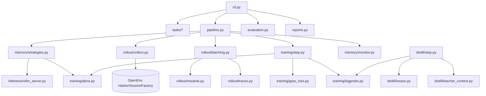
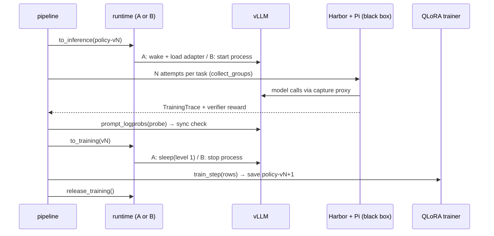

# Code graph: where to start reading

`src/harness_rl/` is split into a **pure core**, which you can test without a GPU, and a **thin I/O shell** (processes, HTTP, CUDA). Read it in this order:

| # | File | What it answers | Pure? |
|---|---|---|---|
| 1 | `rollout/traces.py` | How a captured Pi model call becomes trainable tokens. Which tokens are masked. | yes |
| 2 | `rollout/rewards.py`, `rollout/batching.py` | Verifier reward → group advantage → training rows; the sync probe | yes |
| 3 | `training/grpo_loss.py`, `training/logprobs.py` | The GRPO surrogate (beta=0) and chunked log-probs over the 151k vocab | torch only |
| 4 | `training/step.py`, `training/qlora.py` | One optimizer step on NF4 + LoRA, and the evidence that weights moved | GPU |
| 5 | `memory/strategies.py` | **Strategy A (sleep) vs. B (sequential)**: the Day 1 comparison | GPU + processes |
| 6 | `pipeline.py` | The loop that ties 1–5 together | orchestration |
| 7 | `cli.py` | Entry points | shell |

Then `tasks/` (dataset → splits → Harbor layout), `evaluation.py`, `reports.py`, `distill/` (Experiment B).

## Module dependencies

## One GRPO iteration (`pipeline.iteration`)

## What is reused and what is custom

| Reused unchanged | Custom (allowed by scope s.10) |
|---|---|
| Pi harness, Harbor tasks and verifier, Docker sandbox | GPU hand-over: `memory/strategies.py` |
| OpenEnv capture proxy, `TrainingTrace`, `HarborSessionFactory` | Phase-synchronous scheduler: `pipeline.py` |
| vLLM runtime LoRA loading (`policy-vN` naming, as in TRL) | Privileged teacher scoring: `distill/` |
| TRL's loss rule (`score_centering=False` branch) and advantage rule | Evaluation and reports |
